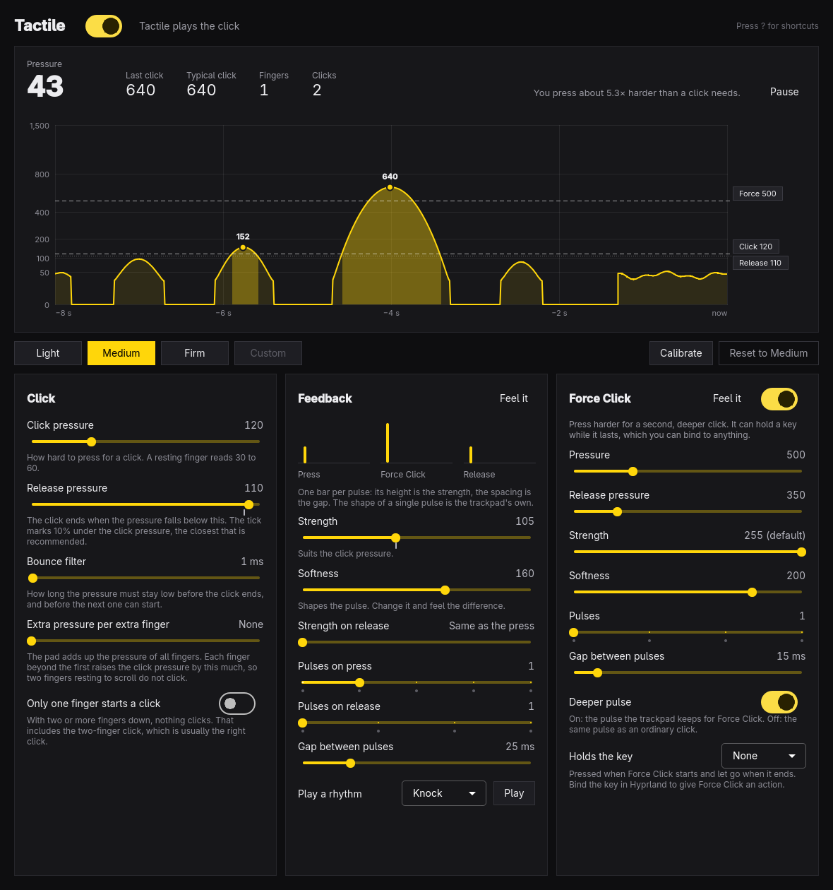

# Tactile



A light, tunable trackpad click for Apple Silicon MacBooks under Linux, with
the trackpad's own haptic feedback.

The trackpad of a MacBook does not move. A click is the pad noticing enough
pressure and firing the actuator underneath. Under Linux that pressure is fixed
by the trackpad's firmware, and it is a good deal heavier than the "Light"
setting in macOS. Tactile lets the driver play the click instead, at the
pressure you choose, with one vibration per press.

It is three parts:

- a small patch to the kernel's `hid-magicmouse` driver, built for your kernel
  by DKMS, so it survives reboots and kernel updates;
- `tactiled`, a service that keeps your settings and applies them at boot;
- `tactile`, a settings window with a live chart of how hard you press, and
  the same thing as commands.

## Status

Written and tested on one machine: a MacBook Pro 14" M1 Pro (2021, `apple,j314s`)
running [Omarchy](https://omarchy.org) with the linux-aurora 7.2.11 kernel.
Other Apple Silicon MacBooks use the same driver, and the patch only changes
what happens on trackpads that hide the report in question, but nobody has
tried another model yet. If you do, please open an issue and say how it went,
either way.

The driver refuses to build for a kernel it was not made for (see
[Safety](#safety)), so on a kernel that differs too much you keep the stock
click instead of a broken trackpad.

## Install

On Omarchy or another Arch-based system on Apple Silicon, with the headers of
your running kernel installed (`linux-aurora-headers` or `linux-asahi-headers`):

```sh
git clone https://github.com/MadejaJiri/tactile
cd tactile
./install.sh
```

`install.sh` builds the package, installs it with `pacman`, starts the service,
and checks that the driver is built for your kernel and is in the boot image.
It asks for your password through `sudo` and tells you what did not work, if
anything. Then open **Tactile** from the launcher (`Super + Space`).

To remove it: `sudo pacman -R tactile`, then reboot. The kernel's own driver is
back and nothing else is left behind except your settings in `/var/lib/tactile`.

## The window

The chart shows the summed pressure of your fingers over the last eight
seconds, on the trackpad's own scale: a resting finger reads 30 to 60, the
firmware's built-in click sits near 125, a firm press peaks around 1000. The
dashed lines are where a click starts and ends; drag them, or use the sliders.
Each press is labelled with its peak, and the line above the chart tells you
how much harder you press than a click needs.

- **Click**: the pressure at which a click starts, the pressure at which it
  ends, and how long the pressure has to stay low before it counts as
  released.
- **Feedback**: how strong the pulse is, its shape, and how many pulses a
  press and a release play. "Feel it" plays the click without clicking.
- **Force Click**: a second, deeper click when you press harder, like macOS.
- **Calibrate** watches your finger glide, then five presses as light as you
  want a click to be, and sets the pressure between the two.
- **Presets**: Light, Medium, Firm, and Firmware, which hands the click back
  to the trackpad exactly as it was before Tactile.

| Key | Action |
|-----|--------|
| `1` `2` `3` `4` | Light, Medium, Firm, Firmware |
| `[` `]` | Click pressure down, up |
| `Space` | Play a test click |
| `C` | Calibrate |
| `F` | Force Click on or off |
| `P` | Pause the chart |
| `R` | Reset to the defaults |
| `Ctrl+Z` / `Ctrl+Shift+Z` | Undo, redo |
| `?` | Show the shortcuts |
| `Q` | Quit |

Every change applies at once and is saved; there is no Apply button. The window
follows the Omarchy theme and language (English and Czech so far).

## Commands

```sh
tactile status                 # driver, trackpad, who plays the click, all settings
tactile set press=80 release=50
tactile preset light           # light, medium, firm, or firmware
tactile click                  # play one click
tactile watch --seconds 5      # the pressure as it changes
tactile keys                   # every setting with its range and default
tactile skill install          # teach a coding agent to use the above
```

Each takes `--json` and exits 0 or 1. None needs `sudo`.

```sh
tactile-driver status          # which driver is installed and which is loaded
sudo tactile-driver reload     # load Tactile's driver now, without a reboot
sudo tactile-driver stock      # the kernel's own driver until the next boot
sudo tactile-driver repair     # find the actuator again if a boot missed it
```

On the machine above, about every other boot the trackpad's controller does not
list the actuator, the part that makes the click, with or without Tactile.
The firmware still clicks then, but the driver has nothing to play its own
click with. Probing the controller again brings the actuator back, so Tactile
checks once at every boot and does that if needed (`tactile-actuator.service`).

Switching drivers by hand pauses the keyboard and the trackpad for about two
seconds, because both sit behind the same controller.

## How it works

The kernel's driver can already play the click itself (`haptic_press=1`), but
on this trackpad a firm press then vibrated twice: once from the driver, and
once more from the firmware, which never stopped clicking on its own. The
request that tells the firmware to stop was silently never sent, because the
trackpad does not announce that it understands it. It does understand it. The
patch sends it, checks that it took, and only then starts playing clicks; the
whole story, with the protocol notes, is in [driver/README.md](driver/README.md).

`tactiled` runs as root with a tight systemd sandbox, because the driver's
options and the trackpad's event device belong to root. The window and the
commands talk to it over a socket in `/run/tactile`. It answers only the user
sitting at the machine (an active local session), accepts only known settings
within their ranges, and forwards three numbers from the trackpad: the summed
pressure, the number of fingers, and whether the button is down. Finger
positions never leave the service, and it does not touch the keyboard.

## Safety

- The firmware's own click is the fallback everywhere. Until the driver has
  confirmed that the trackpad handed the click over, and whenever that fails,
  the stock button and click pass through untouched.
- The patched driver shares private structures with code inside the kernel.
  Before every build, `driver/abi-check.sh` compares the kernel against what
  the patch was made from, and builds nothing if they differ. After a kernel
  update that changes the driver you get the stock click and a line in
  `tactile-driver status`, not a crash. That also means a new kernel can need
  a new Tactile.
- The patch adds one thing the driver says to the trackpad: who plays the
  click. It writes that only while no finger is on the pad, reads it back,
  and hands the click back to the firmware when the driver is unloaded.
- It is a kernel module from outside the kernel tree. It works on the machine
  above; it comes with no warranty.

## Building

```sh
bin/build      # build/tactile and build/daemon/tactiled
bin/test       # the unit tests, offscreen
bin/install    # makepkg -fsi
```

`TACTILE_DEMO=1 build/tactile` opens the window with made-up presses and no
service, which is how the screenshot above was taken.

## Licence

The app, the service, and the tools are MIT. The driver in `driver/` is
GPL-2.0-or-later, like the kernel file it patches. See [LICENSE](LICENSE).
